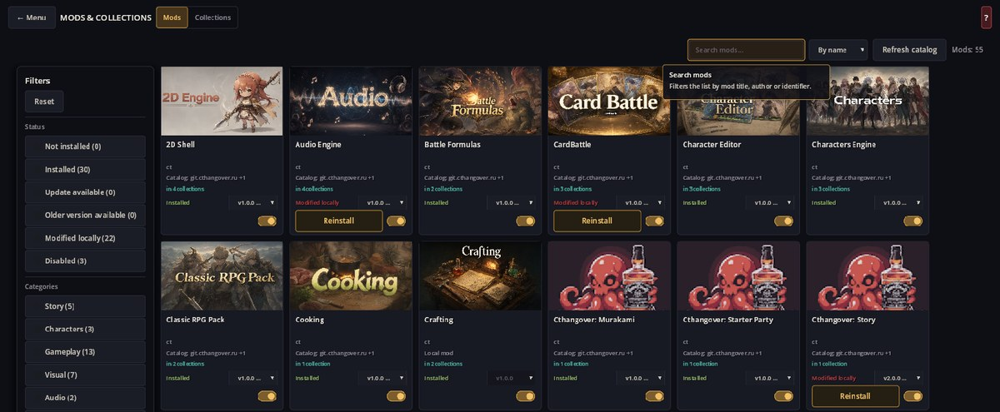
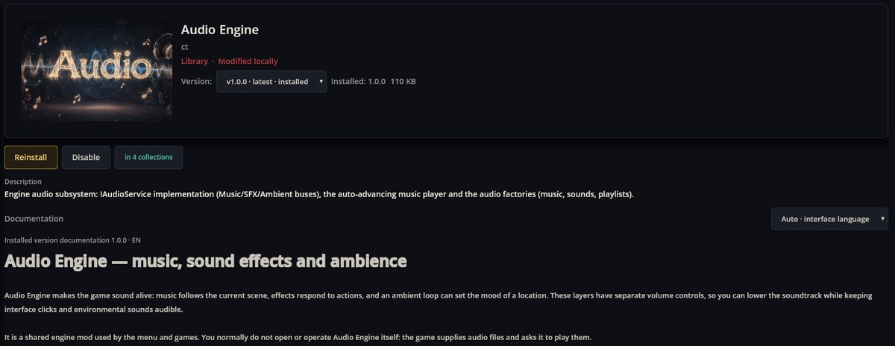
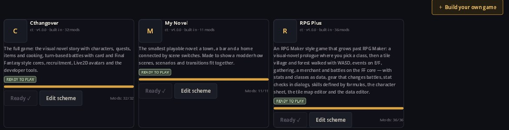
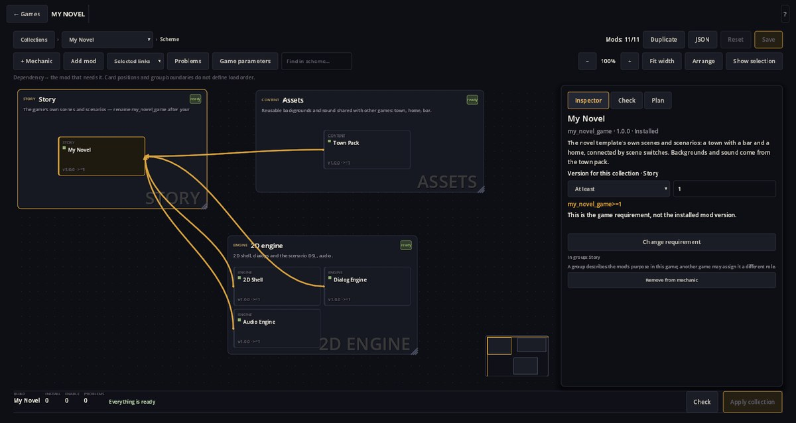
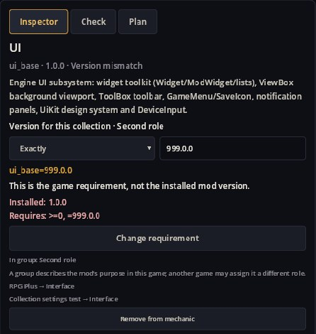

# Mod Manager — mods, games and their documentation

Mod Manager is the **Mods & Collections** screen of the main menu. Use it to see which mods are installed, read what each one does, install or update mods from the online catalog, switch mods off, and look inside the ready-made games to see which mods they are built from.

It is part of the shell that is always loaded with the menu, so it works even before you start a game.

## Open it

In the main menu choose **Mods & Collections**. The screen has two tabs:

- **Mods** — every mod the game knows: installed ones and those offered by the catalog.
- **Collections** — the ready-made games, and the scheme of mods each game is built from.

**← Menu** returns to the main menu. The **?** button in the top-right corner, or **F1**, turns on contextual hints: hover over a control to see what it does, click to pin the hint, **Esc** to leave.

## Browse the mods

Each card shows the mod's cover, title, author, the catalog it comes from, how many games use it (**in 4 collections**), its state and version, and an on/off switch.

- **Search mods…** filters by title, author or identifier.
- **By name / By author / By status** sorts the list.
- **Filters** on the left narrow the list by **Status** (Not installed, Installed, Update available, Older version available, Modified locally, Disabled) and by **Categories** such as Story, Gameplay, Visual, Audio, Library, Engine and Tools. **Reset** clears filters and search.
- **Refresh catalog** downloads the current list of published mods.

*Modified locally* means the installed files differ from the catalog's copy of the same version — for example, a mod you are editing yourself.

## Read about a mod

Click a card to open its page: the cover, version selector, actions, the short description from the mod's manifest and, when the mod provides one, its **Documentation** — a full guide like this one.

The documentation is the guide of the **installed** version. If you choose another version in the version selector, a note reminds you that the guide below still belongs to the installed one.

**Documentation language.** The selector at the right of the Documentation heading starts on **Auto · interface language**: the guide follows the language of the game's interface. If the mod has no guide in that language, the manager shows the mod's default guide, then English, then the first available one; the line above the guide names the language actually shown (for example `EN`). You can also pick a language from the selector yourself. A mod without any guide keeps showing its manifest description.

For mod authors: put the guide in `docs/en.md` (and `docs/<language>.md` for translations, or `docs/default.md`) and images next to it, for example `docs/assets/screen.png`, referenced as `assets/screen.png`. The viewer shows headings, paragraphs, lists, quotes, code blocks, links and PNG/JPEG/WebP images; it does not run HTML, tables or animations.

## Install, update, switch off, delete

The buttons on a mod page and the switch on its card:

- **Install / Update / Downgrade / Reinstall** download the selected version from the catalog into your user folder (`user://mods/`).
- **Disable / Enable** (or the card's switch) decide whether the mod is loaded. A disabled mod keeps its files and the data in your saves.
- **Delete** removes a downloaded mod after confirmation.

After any of these a banner says **Changes will take effect after restarting the game**. Mod Manager itself cannot be deleted or disabled from its own screen.

**Installed is not the same as used.** A game loads the mods named in its collection, plus the menu shell. Installing a mod makes it available; it appears in a game only when that game's collection includes it.

## Games and collections

The **Collections** tab first shows the ready-made games. A game is a *collection*: a named set of mods with the place to start.

A card tells you whether everything the game needs is installed (**Ready to play**, or **Missing N** / **Install (N)** / **Enable (N)**). One button installs or enables what is missing. **Edit scheme** opens the game's structure; **+ Build your own game** starts a new collection.

### The scheme of a game

The scheme shows the game's *mechanics* (blocks such as Story, Assets, 2D engine) and the mods inside them. Arrows go from a dependency to the mod that needs it. Card positions and blocks are only for reading: they do not decide load order.

Select a block or a mod to see it in the **Inspector**. There you can change the version the game requires — **Any**, **At least**, **Exactly**, **Branch** (`^1` accepts any 1.x) and others. This is the game's requirement, not the version you have installed. **Check** lists problems; **Plan** shows what applying the collection would install or enable.

Other buttons of the scheme: **+ Mechanic** and **Add mod** change the game, **Duplicate** makes your own copy (and offers to copy the saves), **JSON** shows the raw definition, **Save** and **Reset** keep or discard changes, **Apply collection** installs and enables what the plan lists. A built-in game you changed can be restored with **Revert to built-in**; your saves stay.

Changes to a game apply the next time it starts. Saves of a game remain usable when its mods change: data of mods that left the game is kept aside and comes back with the mod.

## If something goes wrong

1. **A mod does not appear in a game.** Check that it is enabled and that the game's collection includes it (open **Edit scheme**).
2. **"Install failed".** Check the internet connection and try **Refresh catalog** again.
3. **A game card says Missing or Problems.** Open its scheme and the **Check** tab: it lists missing mods, version gaps and conflicts.
4. **Catalog conflict.** The same mod and version is published with different content by two catalogs; prefer the catalog you trust.
5. **No documentation section.** The mod has no `docs/` guide yet; its manifest description is shown instead.
