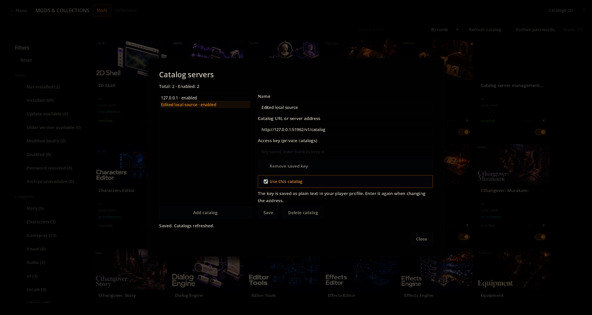
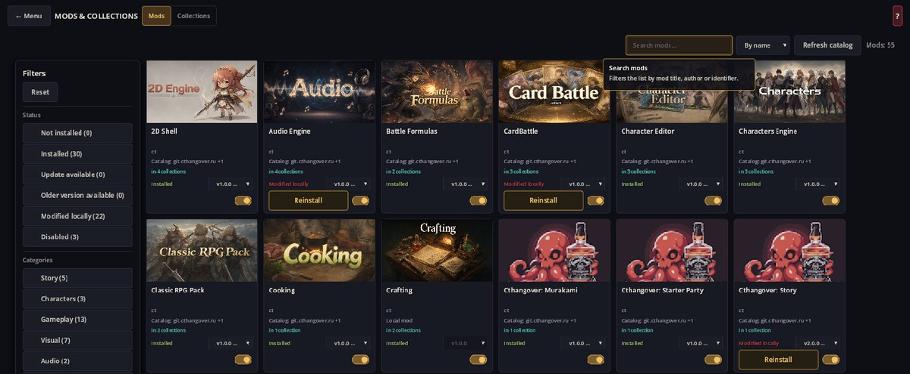
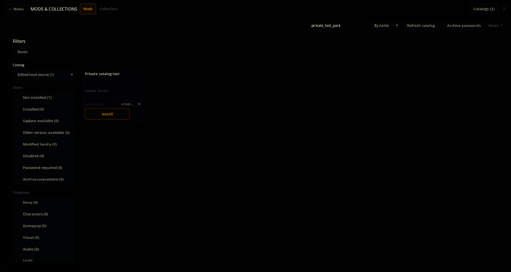
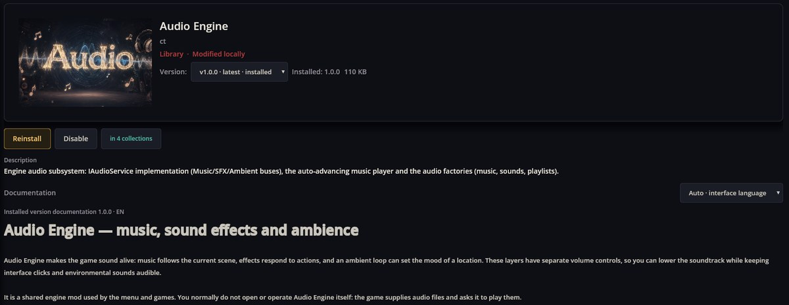
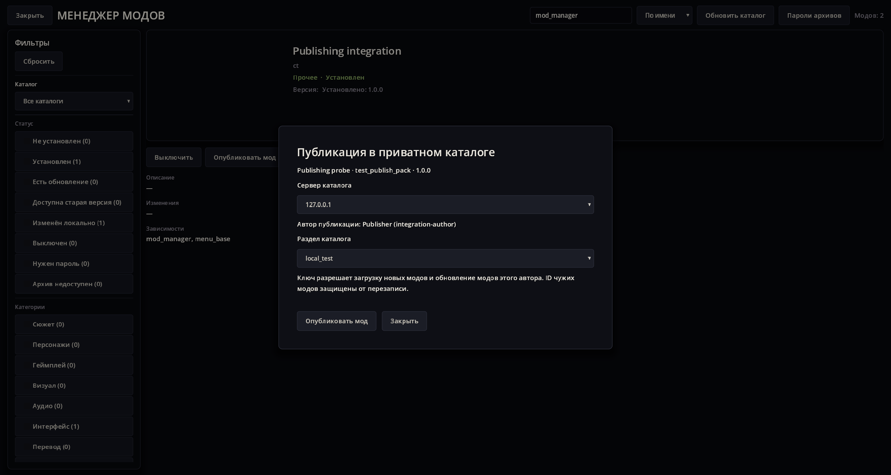
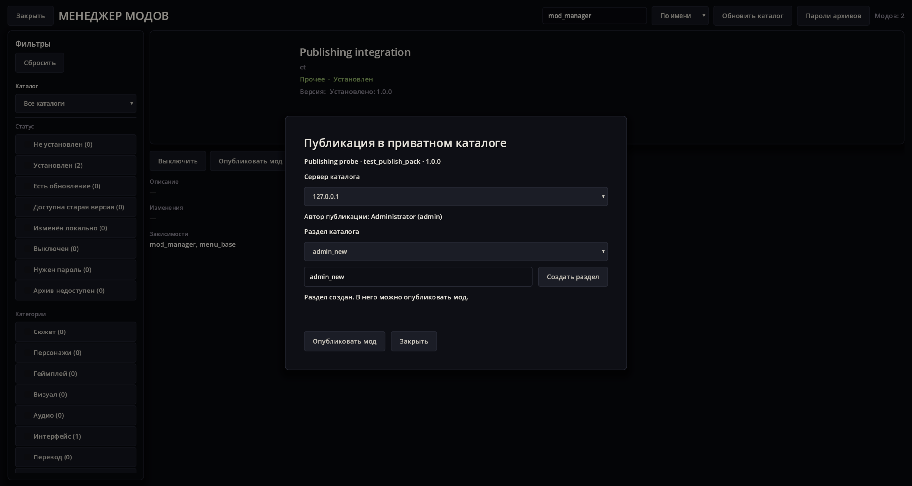
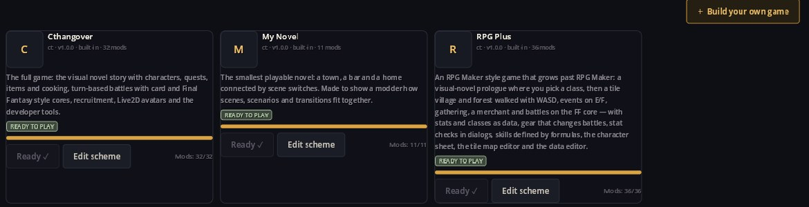
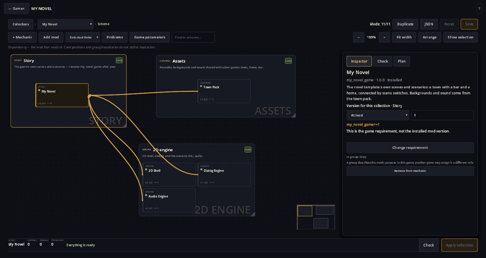
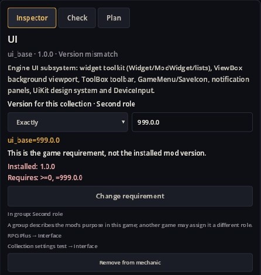

# Mod Manager — mods, games and their documentation

Mod Manager is the **Mods & Collections** screen of the main menu. Use it to see which mods are installed, read what each one does, install or update mods from the online catalog, switch mods off, and look inside the ready-made games to see which mods they are built from.

It is part of the shell that is always loaded with the menu, so it works even before you start a game.

## Open it

In the main menu choose **Mods & Collections**. The screen has two tabs:

- **Mods** — every mod the game knows: installed ones and those offered by the catalog.
- **Collections** — the ready-made games, and the scheme of mods each game is built from.

**← Menu** returns to the main menu. The **?** button in the top-right corner, or **F1**, turns on contextual hints: hover over a control to see what it does, click to pin the hint, **Esc** to leave.

## Catalog servers

The **Catalogs (N)** button in the top header shows the number of saved servers. Open it to see the full list and how many sources are enabled. Select a server on the left to edit its name, address, key or **Use this catalog** switch. **Add catalog** opens an empty form; **Delete catalog** removes a source after confirmation. Installed mods remain available.

For a local keyserver enter **127.0.0.1:18080**; the manager completes it to `http://127.0.0.1:18080/v1/catalog`. A full catalog URL such as `https://example.com/catalog.json` also works. Paste the issued token into **Access key** for a private catalog, or leave it blank for a public catalog. For the `cthangover-keyserver` local fixture, copy the line from `local-dev/local.token` created by `run_local.bat`.

**Save** applies changes and refreshes catalogs immediately. Settings survive a game restart; no JSON editing is needed. Saved keys are never filled back into the form: leave the field blank to keep the key or choose **Remove saved key** to clear it. Changing the endpoint requires entering the key again. Keys are stored as plain text in your player profile. A disabled server stays listed but is not requested.

## Browse the mods

Each card shows the mod's cover, title, author, the catalog it comes from, how many games use it (**in 4 collections**), its state and version, and an on/off switch.

- **Search mods…** filters by title, author or identifier.
- **By name / By author / By status** sorts the list.
- **Filters** on the left narrow the list by **Status** (Not installed, Installed, Update available, Older version available, Modified locally, Disabled) and by **Categories** such as Story, Gameplay, Visual, Audio, Library, Engine and Tools. **Reset** clears filters and search.
- **Refresh catalog** downloads the current list of published mods.

**Catalog** in the left sidebar starts on **All catalogs**. Select a server to show only the mods that it publishes, or **Local only** for mods without a catalog entry. Catalog selection works together with search, status and category filters; the number beside each source respects those other filters. A mod published in several catalogs matches any of its sources. **Reset** returns to all catalogs.

*Modified locally* means the installed files differ from the catalog's copy of the same version — for example, a mod you are editing yourself.

## Read about a mod

Click a card to open its page: the cover, version selector, actions, the short description from the mod's manifest and, when the mod provides one, its **Documentation** — a full guide like this one.

The documentation is the guide of the **installed** version. If you choose another version in the version selector, a note reminds you that the guide below still belongs to the installed one.

**Documentation language.** The selector at the right of the Documentation heading starts on **Auto · interface language**: the guide follows the language of the game's interface. If the mod has no guide in that language, the manager shows the mod's default guide, then English, then the first available one; the line above the guide names the language actually shown (for example `EN`). You can also pick a language from the selector yourself. A mod without any guide keeps showing its manifest description.

For mod authors: put the guide in `docs/en.md` (and `docs/<language>.md` for translations, or `docs/default.md`) and images next to it, for example `docs/assets/screen.png`, referenced as `assets/screen.png`. The viewer shows headings, paragraphs, lists, quotes, code blocks, links and PNG/JPEG/WebP images; it does not run HTML, tables or animations.

## Install, update, switch off, delete

The buttons on a mod page and the switch on its card:

- **Install / Update / Downgrade / Reinstall** download the selected version from the catalog into your user folder (`user://mods/`).
- **Disable / Enable** (or the card's switch) decide whether the mod is loaded. A disabled mod keeps its files and the data in your saves.
- **Delete** removes a downloaded mod after confirmation.

After any of these a banner says **Changes will take effect after restarting the game**. Mod Manager itself cannot be deleted or disabled from its own screen.

**Installed is not the same as used.** A game loads the mods named in its collection, plus the menu shell. Installing a mod makes it available; it appears in a game only when that game's collection includes it.

## Publish your mods

Open an installed mod's page and choose **Publish mod**. Select an enabled private
catalog with a saved key, check the publisher shown by the server, and choose a
section. Press **Publish mod** in the form and wait for success. The manager then
refreshes the catalog.

Folder mods become ZIP packages with hidden files, including `.git`, excluded.
Existing ZIP/7z packages keep their format and encryption. Archives can be up to
200 MiB. One author may own at most 100 mods on a server; updates of mods the
author already owns do not count against this limit. If you edited the manifest while the game was running, publishing uses
the version and description from the package being sent.

To update, publish the new version with the same mod ID in its existing section,
using a key for the same author. Earlier versions remain available. Another author
cannot overwrite your ID; matching manifest author credits grant no rights.
Ask the catalog owner to preserve your publisher identity when renewing a key.
Older keys may allow reading only; the catalog owner must issue a publishing key.
For mods previously added by the administrator, they must also assign ownership.

**Masked access.** The catalog owner may grant a group of sections such as
`rpg_*`. The form then accepts a concrete permitted name. A wildcard grant does
not allow overwriting another author's mod.

**Administrator key.** This key enables every section, a new section name and
**Create section**. The empty section is created both in the catalog and its
storage folders. Administrators can update any mod while retaining its original
owner.

The server can also build its catalog automatically from folders uploaded through
WinSCP. These appear as ordinary catalog entries. Removing a version from those
folders withdraws it from the current catalog; players keep installed copies.

## Publish collections

Choose **Publish collection** on a local or built-in collection's gallery card
or in its scheme editor. Remote catalog entries must first become local
packages. The shared form shows required mods and included collections and
warns about unavailable references; the warning does not prevent publication.

Destinations show the catalog name and full URL, including port and path.
Reader-only keys are excluded. With several destinations, choose one explicitly;
only this entity's last successful destination is selected automatically. Check
the verified author and section, read and accept any author consent, then send.
The result names the destination. Mod publication follows the same rules.

A collection ZIP contains only its document, cover and locales, up to 16 MiB;
mods are downloaded separately. Collections have their own 100-ID quota,
independent of mods. Repeating a publication is safe and a new version retains
history. The installer saves the cover and locales with the collection.
**Ready to play** requires every mod installed and enabled. Otherwise the badge
shows downloads, enabling, or unavailable dependencies instead.

## Games and collections

The **Collections** tab first shows the ready-made games. A game is a *collection*: a named set of mods with the place to start.

A card tells you whether everything the game needs is installed (**Ready to play**, or **Missing N** / **Install (N)** / **Enable (N)**). One button installs or enables what is missing. **Edit scheme** opens the game's structure; **+ Build your own game** starts a new collection.

### The scheme of a game

The scheme shows the game's *mechanics* (blocks such as Story, Assets, 2D engine) and the mods inside them. Arrows go from a dependency to the mod that needs it. Card positions and blocks are only for reading: they do not decide load order.

Select a block or a mod to see it in the **Inspector**. There you can change the version the game requires — **Any**, **At least**, **Exactly**, **Branch** (`^1` accepts any 1.x) and others. This is the game's requirement, not the version you have installed. **Check** lists problems; **Plan** shows what applying the collection would install or enable.

Other buttons of the scheme: **+ Mechanic** and **Add mod** change the game, **Duplicate** makes your own copy (and offers to copy the saves), **JSON** shows the raw definition, **Save** and **Reset** keep or discard changes, **Apply collection** installs and enables what the plan lists. A built-in game you changed can be restored with **Revert to built-in**; your saves stay.

Changes to a game apply the next time it starts. Saves of a game remain usable when its mods change: data of mods that left the game is kept aside and comes back with the mod.

### Make a mod and choose the start

The tools row of a game has **New mod** and **Start scene**. **New mod** asks for a title, an id (it follows the title until you type one), a description, the base mod (the game's own content first, then RPG world or dialogs and scenes) and the game it joins. It writes a folder of plain files in the mods folder — `manifest.json`, a `locale/` stub with the title, and empty `scenes/`, `scenarios/` and `src/` folders — and adds the mod to the game as its own block. No repository is created. **Start scene** lists the scenes that the game's installed mods define and sets where a new game starts; **Save** keeps it. The mod and the start take effect at the next launch. Use the translations window to fill in the titles in other languages.

To make a first game step by step, with the mouse only, read **Your first game in 10 minutes** in the documentation of **RPG Map Editor** (the mod `rpg_editor`): it starts with **New mod** and ends with the character sheet.

## If something goes wrong

1. **A mod does not appear in a game.** Check that it is enabled and that the game's collection includes it (open **Edit scheme**).
2. **"Install failed".** Check the internet connection and try **Refresh catalog** again.
3. **A game card says Missing or Problems.** Open its scheme and the **Check** tab: it lists missing mods, version gaps and conflicts.
4. **Red "Unsafe" card.** Several catalogs publish a mod with the same ID, but their content hashes differ. It is unknown which copy is genuine, so the cards of this mod from every catalog are marked red. Do not install it and tell the catalog administrators.
5. **No documentation section.** The mod has no `docs/` guide yet; its manifest description is shown instead.
