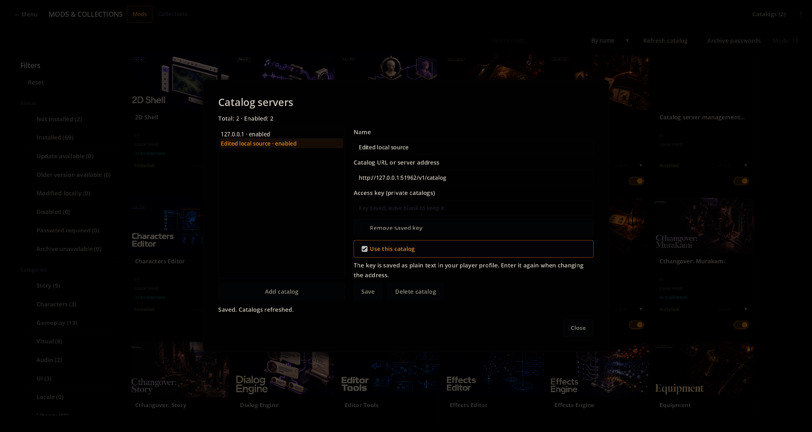
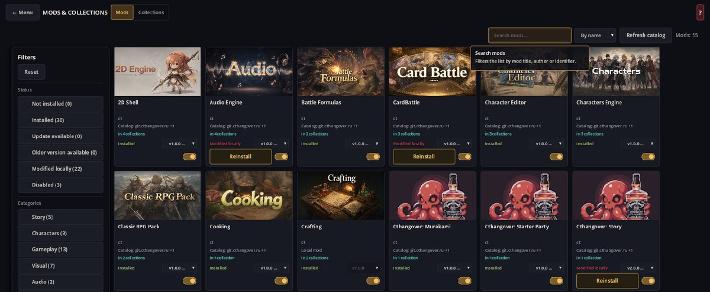
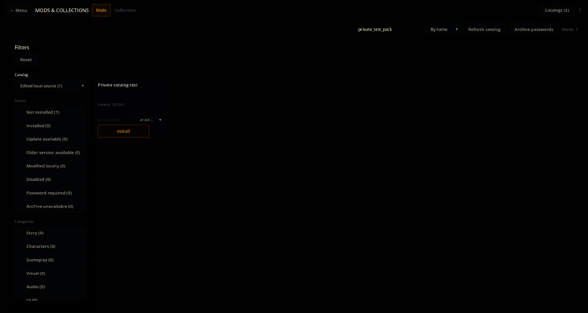
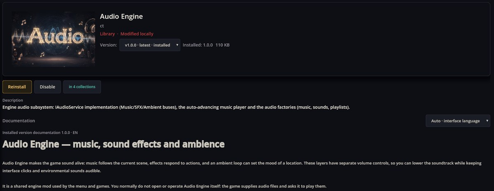
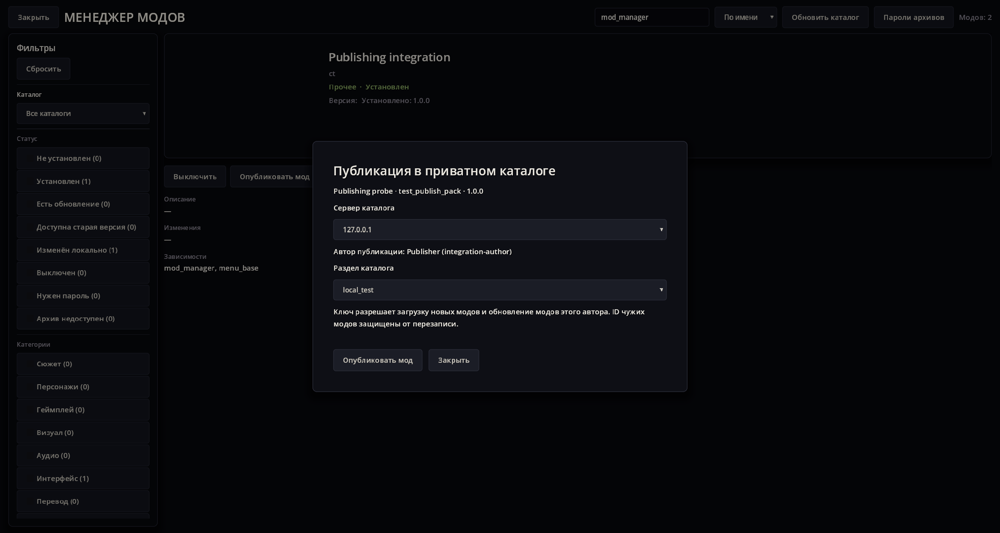
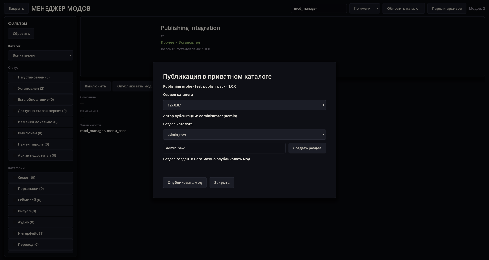
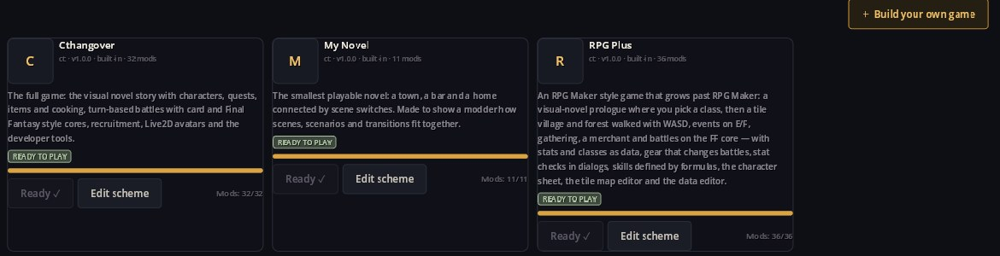
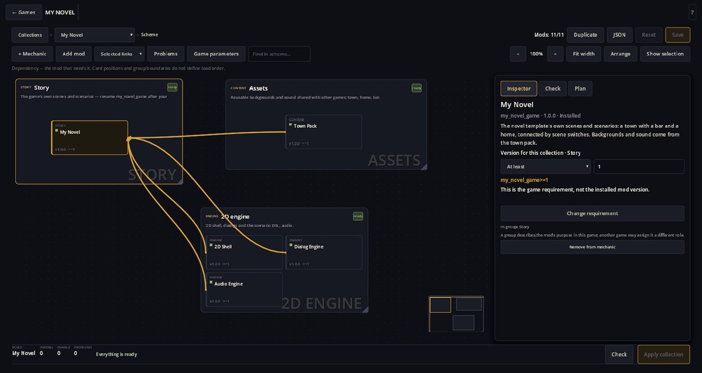
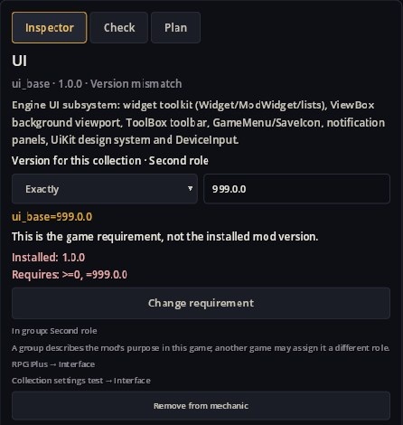

# Mod Manager — моды, игры и их документация

Mod Manager — это экран **Моды и коллекции** главного меню. Здесь видно, какие моды установлены, что делает каждый из них, отсюда устанавливают и обновляют моды из онлайн-каталога, выключают моды и заглядывают внутрь готовых игр, чтобы понять, из каких модов они собраны.

Он входит в оболочку, которая всегда загружается вместе с меню, поэтому работает ещё до запуска любой игры.

## Как открыть

В главном меню выберите **Моды и коллекции**. У экрана две вкладки:

- **Моды** — все моды, которые известны игре: установленные и предложенные каталогом.
- **Коллекции** — готовые игры и схема модов, из которых собрана каждая.

Кнопка **← Меню** возвращает в главное меню. Кнопка **?** в правом верхнем углу, или **F1**, включает контекстные подсказки: наведите курсор на элемент управления, чтобы узнать, что он делает, щёлкните, чтобы закрепить подсказку, **Esc** — чтобы уйти.

## Каталог-серверы

Кнопка **Каталоги (N)** в верхней панели показывает число сохранённых серверов. Откройте её, чтобы увидеть весь список и сколько источников включено. Выберите сервер слева, чтобы изменить его название, адрес, ключ или переключатель **Использовать этот каталог**. **Добавить каталог** открывает пустую форму; **Удалить каталог** удаляет источник после подтверждения. Установленные моды сохраняются.

Для локального сервера введите **127.0.0.1:18080** — менеджер дополнит адрес до `http://127.0.0.1:18080/v1/catalog`. Можно указать полный URL файла каталога, например `https://example.com/catalog.json`. Для приватного каталога вставьте выданную строку в **Ключ доступа**; для открытого оставьте поле пустым. Для стенда `cthangover-keyserver` скопируйте строку из `local-dev/local.token`, созданного `run_local.bat`.

**Сохранить** сразу применяет изменения и обновляет каталоги. Настройки сохраняются между запусками игры; JSON вручную править не нужно. Сохранённый ключ скрыт: пустое поле при редактировании сохраняет его, **Удалить сохранённый ключ** убирает его. При смене адреса введите ключ заново. Ключ хранится в профиле игрока в открытом виде. Отключённый сервер остаётся в списке, но не запрашивается.

## Обзор модов

На каждой карточке — обложка, название, автор, каталог, откуда мод, сколькими играми он используется (**в 4 коллекциях**), состояние и версия, а также переключатель вкл/выкл.

- **Поиск модов...** фильтрует по названию, автору или идентификатору.
- **По имени / По автору / По статусу** сортируют список.
- **Фильтры** слева сужают список по **статусу** (Не установлен, Установлен, Есть обновление, Доступна старая версия, Изменён локально, Выключен) и по **категориям** — например Сюжет, Геймплей, Визуал, Аудио, Библиотека, Движок, Инструменты. **Сбросить** очищает фильтры и поиск.
- **Обновить каталог** скачивает актуальный список опубликованных модов.

В секции **Каталог** слева по умолчанию выбраны **Все каталоги**. Выберите сервер, чтобы увидеть только публикуемые им моды, или **Только локальные** для модов без записи в каталоге. Выбор сочетается с поиском, статусом и категорией; число рядом с источником учитывает остальные фильтры. Мод из нескольких каталогов находится по любому из них. **Сбросить** возвращает все каталоги.

*Изменён локально* значит, что установленные файлы отличаются от копии той же версии в каталоге, — например, мод, который вы правите сами.

## Описание мода

Щёлкните по карточке, чтобы открыть её страницу: обложка, выбор версии, действия, краткое описание из манифеста мода и, если мод его предоставляет, **Документация** — подробное руководство вроде этого.

Документация — это руководство **установленной** версии. Если выбрать в селекторе другую версию, пометка напомнит, что руководство ниже по-прежнему относится к установленной.

**Язык документации.** Селектор справа от заголовка «Документация» стартует на значении **Авто · язык интерфейса**: руководство следует за языком интерфейса игры. Если руководства на этом языке у мода нет, менеджер покажет руководство мода по умолчанию, затем английское, затем первое доступное; строка над руководством называет реально показанный язык (например, `EN`). Язык можно выбрать и вручную. У мода без руководств вместо них остаётся описание из манифеста.

Авторам модов: положите руководство в `docs/en.md` (переводы — в `docs/<язык>.md`, либо `docs/default.md`), а картинки рядом, например `docs/assets/screen.png`, со ссылкой `assets/screen.png`. Просмотрщик понимает заголовки, абзацы, списки, цитаты, блоки кода, ссылки и картинки PNG/JPEG/WebP; HTML, таблицы и анимации он не исполняет.

## Установка, обновление, выключение, удаление

Кнопки на странице мода и переключатель на карточке:

- **Установить / Обновить / Понизить / Переустановить** скачивают выбранную версию из каталога в вашу пользовательскую папку (`user://mods/`).
- **Выключить / Включить** (или переключатель на карточке) решают, загружается ли мод. Выключенный мод хранит файлы и данные в ваших сохранениях.
- **Удалить** стирает скачанный мод после подтверждения.

После любого из этих действий появляется плашка **Изменения вступят в силу после перезапуска игры**. Сам Mod Manager нельзя удалить или выключить с его собственного экрана.

**Установлен — ещё не значит используется.** Игра загружает моды, названные в её коллекции, плюс оболочку меню. Установка делает мод доступным; в игре он появится, только когда коллекция этой игры его включит.

## Публикация своих модов

На странице установленного мода нажмите **Опубликовать мод**. Выберите включённый
приватный каталог с сохранённым ключом, проверьте показанного автора и выберите
раздел. Нажмите **Опубликовать мод** в форме и дождитесь сообщения об успехе:
каталог обновится автоматически.

Папка мода упаковывается в ZIP без скрытых файлов, включая `.git`. Готовый
ZIP/7z отправляется с сохранением формата и шифрования. Размер архива — до
200 МиБ. Один автор может владеть не более чем 100 модами на сервере; обновления
уже принадлежащих ему модов в этот лимит не входят. Если вы меняли манифест во время работы игры, при публикации используются
версия и описание из отправляемого пакета.

Для обновления опубликуйте новую версию с прежним ID в том же разделе и с ключом
того же автора. Старые версии остаются в каталоге. Другой автор не может
перезаписать ваш ID; одинаковое имя автора в манифесте не даёт такого права.
При продлении ключа попросите владельца каталога сохранить вашу идентичность
автора. Старые ключи могут разрешать только чтение — тогда владелец каталога
должен выдать ключ с правом публикации. Для модов, ранее добавленных
администратором, он также должен назначить владельца.

**Доступ по маске.** Владелец каталога может разрешить группу разделов, например
`rpg_*`. Тогда в форме можно ввести конкретное разрешённое имя. Звёздочка в
правах не разрешает перезаписывать чужие моды.

**Ключ администратора.** При таком ключе доступны все разделы, ввод нового имени
и кнопка **Создать раздел**. Пустой раздел создаётся и на сервере, и в папках
хранилища. Администратор может обновлять любые моды; первоначальный владелец
сохраняется.

Сервер также может автоматически собирать каталог из папок, загруженных через
WinSCP. Для игрока они появляются как обычные записи каталога. Если администратор
удалит версию из такой папки, она исчезнет из текущей выдачи; уже установленные
копии останутся у игроков.

## Публикация коллекций

На карточке локальной или встроенной коллекции в галерее либо в редакторе
схемы нажмите **«Опубликовать коллекцию»**. Каталожная запись сначала должна
стать локальным пакетом. Общая форма показывает требуемые моды и включённые
коллекции; недоступные ссылки отмечены предупреждением, которое не блокирует
отправку.

В назначении видны имя каталога и полный URL с портом и путём. Ключи только
для чтения исключаются. Если серверов несколько, выбор обязателен; автоматически
подставляется только прошлое успешное назначение этой сущности. Проверьте
подтверждённого автора и раздел, прочитайте и примите согласие автора, если
его требует сервер, затем отправьте пакет. Итог содержит адрес назначения.
Для публикации мода действуют те же правила выбора.

ZIP коллекции содержит только документ, обложку и локали, до 16 МиБ. Моды
скачиваются отдельно. Лимит 100 ID коллекций независим от модов. Повторная
публикация безопасна, новая версия сохраняет историю. При установке обложка
и локали сохраняются вместе с коллекцией. Плашка **«Готово к игре»** требует
установки и включения всех модов; иначе показана необходимость скачивания,
включения или недоступные зависимости.

## Игры и коллекции

Вкладка **Коллекции** сначала показывает готовые игры. Игра — это *коллекция*: поименованный набор модов и место, с которого начинается игра.

Карточка сообщает, установлено ли всё, что нужно игре (**Готова к игре**, либо **Не хватает N** / **Установить (N)** / **Включить (N)**). Одна кнопка устанавливает или включает недостающее. **Изменить схему** открывает устройство игры; **＋ Собрать свою игру** начинает новую коллекцию.

### Схема игры

Схема показывает *механики* игры (блоки вроде Story, Assets, 2D engine) и моды внутри них. Стрелки идут от зависимости к моду, которому она нужна. Положение карточек и сами блоки нужны только для чтения: порядок загрузки они не задают.

Выберите блок или мод — он откроется в **Инспекторе**. Там меняется версия, которую требует игра: **Любая**, **Не ниже**, **Точно**, **Ветка** (`^1` принимает любую 1.x) и другие. Это требование игры, а не версия, установленная у вас. **Проверка** перечисляет проблемы; **План** показывает, что применит установка коллекции.

Прочие кнопки схемы: **+ Механика** и **Добавить мод** меняют игру, **Дублировать** делает вашу копию (и предлагает скопировать сохранения), **JSON** показывает исходное описание, **Сохранить** и **Сбросить** оставляют или отбрасывают правки, **Применить коллекцию** устанавливает и включает то, что перечислено в плане. Изменённую встроенную игру можно вернуть кнопкой **Вернуть встроенную**; сохранения останутся на месте.

Изменения игры применятся при её следующем запуске. Сохранения игры остаются рабочими при смене её модов: данные модов, покинувших игру, откладываются в сторону и возвращаются вместе с модом.

### Новый мод и стартовая сцена

На панели инструментов игры есть **Новый мод** и **Стартовая сцена**. **Новый мод** спрашивает название, идентификатор (он повторяет название, пока вы не введёте свой), описание, основу (сначала контент самой игры, затем RPG-мир или диалоги и сцены) и игру, в которую мод войдёт. Он создаёт папку с обычными файлами в папке модов: `manifest.json`, заготовку `locale/` с названием и пустые папки `scenes/`, `scenarios/` и `src/`, и добавляет мод в игру отдельным блоком. Репозиторий не создаётся. **Стартовая сцена** показывает сцены, которые определяют установленные моды игры, и задаёт, с чего начинается новая игра; **Сохранить** оставляет выбор. Мод и стартовая сцена работают при следующем запуске. Названия на других языках заполняет окно переводов.

Чтобы сделать первую игру пошагово, только мышью, прочитайте **Первая игра за 10 минут** в документации **RPG Map Editor** (мод `rpg_editor`): путь начинается с **Новый мод** и заканчивается листом персонажа.

## Если что-то пошло не так

1. **Мода нет в игре.** Проверьте, что он включён, и что коллекция игры его содержит (откройте **Изменить схему**).
2. **«Не удалось установить».** Проверьте подключение к интернету и снова нажмите **Обновить каталог**.
3. **На карточке игры «Не хватает» или «Проблемы».** Откройте её схему и вкладку **Проверка**: там перечислены недостающие моды, несовпадения версий и конфликты.
4. **Красная карточка «Небезопасно».** Несколько каталогов публикуют мод с одним ID, но хеши содержимого различаются. Какая копия подлинная, неизвестно, поэтому красными помечены карточки этого мода из всех каталогов. Не устанавливайте его и сообщите администраторам каталогов.
5. **Нет раздела документации.** У мода пока нет руководства в `docs/`; вместо него показано описание из манифеста.
